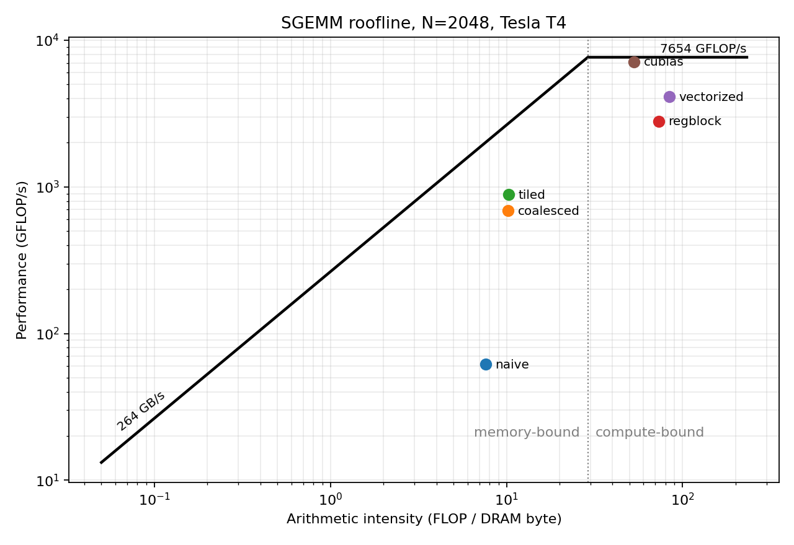

# cuda-sgemm

A single-precision matrix multiply (`C = A * B`) written in CUDA C++ and optimized in stages,
each benchmarked against cuBLAS and profiled with Nsight Compute to see whether it is limited
by memory or by arithmetic.

**Result (Tesla T4, N=2048):** the final kernel reaches 4.1 TFLOP/s, 67x faster than the naive kernel and
58% of cuBLAS. Register blocking is the step that moves it from memory-bound to compute-bound.
Full tables are in [Results](#results).



## Stages

| # | Kernel | What changes | What it fixes |
|---|--------|--------------|---------------|
| 0 | `naive` | one thread per output element, `threadIdx.x` indexes the row | baseline: every warp access is 32 separate transactions |
| 1 | `coalesced` | `threadIdx.x` indexes the column | warp reads of `B` and writes of `C` become one 128-byte transaction |
| 2 | `tiled` | 32x32 tiles of `A` and `B` staged in shared memory | each global element is fetched once per block, not once per thread |
| 3 | `regblock` | each thread computes an 8x8 patch held in registers (128x128 block, 8-deep K step) | shared-memory loads per FMA drop from 2 to 1/4 |
| 4 | `vectorized` | `float4` global loads and stores, `A` tile stored transposed | 4x fewer load instructions, contiguous shared-memory reads |

All kernels are in [src/kernels.cuh](src/kernels.cuh); the comment above each one explains the access pattern.

## Results

Tesla T4 (Google Colab), measured with the commands in the sections below. Raw timings: [docs/bench_t4.csv](docs/bench_t4.csv).
Measured ceilings: 264 GB/s DRAM bandwidth, 7654 GFLOP/s FMA peak, so the roofline ridge is at 29 FLOP/byte.

Correctness: every kernel matches a double-precision host recomputation of 512 sampled entries to a
relative error of 1.2e-6 or better at all three sizes (cuBLAS scores the same against that reference).

GFLOP/s by matrix size (best of up to 10 runs):

| Kernel | N=1024 | N=2048 | N=4096 | % of cuBLAS (N=2048) |
|--------|-------:|-------:|-------:|---------------------:|
| naive | 61 | 62 | 62 | 0.9 |
| coalesced | 812 | 687 | 556 | 9.6 |
| tiled | 869 | 884 | 868 | 12.4 |
| regblock | 2230 | 2808 | 2468 | 39.3 |
| vectorized | 3329 | 4122 | 3305 | 57.7 |
| cuBLAS | 6026 | 7141 | 6364 | 100 |

Roofline at N=2048, with FLOPs and DRAM bytes from Nsight Compute:

| Kernel | DRAM traffic | FLOP/byte | GFLOP/s | % of roof | Regime |
|--------|-------------:|----------:|--------:|----------:|--------|
| naive | 2261 MB | 7.6 | 62 | 3.1 | memory-bound |
| coalesced | 1685 MB | 10.2 | 687 | 25.5 | memory-bound |
| tiled | 1676 MB | 10.3 | 884 | 32.6 | memory-bound |
| regblock | 235 MB | 73.1 | 2808 | 36.7 | compute-bound |
| vectorized | 204 MB | 84.1 | 4122 | 53.9 | compute-bound |
| cuBLAS | 325 MB | 52.9 | 7141 | 93.3 | compute-bound |

What the numbers show:

- **Coalescing is an 11x win without changing the traffic much.** Every kernel executes the same 2N^3 FLOPs
  (Nsight Compute counts 8.59e9 FMAs for each), and naive and coalesced move a similar number of DRAM
  bytes. The gain comes from issuing one transaction per warp instead of 32.
- **Shared-memory tiling alone does not leave the memory-bound region.** It is 1.3x faster than coalesced,
  but its DRAM traffic is unchanged and it still sits left of the ridge: with one output per thread, every
  FMA still needs two loads.
- **Register blocking is the step that crosses the ridge.** DRAM traffic drops 7x, intensity goes from 10
  to 73 FLOP/byte, and the kernel becomes compute-bound (3.2x over tiled).
- **Vectorized loads add another 1.5x**, reaching 58% of cuBLAS and 54% of the measured FMA peak.
- **cuBLAS runs at 93% of the measured FMA peak.** The remaining gap for the hand-written kernel is on the
  compute side (instruction mix and scheduling inside the inner loop), not in memory traffic: it already
  moves fewer DRAM bytes than cuBLAS does.

## Build and run (needs an NVIDIA GPU and the CUDA toolkit)

```bash
cmake -B build && cmake --build build -j
```

or without CMake:

```bash
mkdir -p build && nvcc -O3 -std=c++17 -lineinfo src/main.cu -o build/sgemm -lcublas
```

Benchmark every stage at N = 1024, 2048, 4096:

```bash
./build/sgemm
```

This prints time, GFLOP/s and percent of cuBLAS for each stage, checks the result against cuBLAS and against a double-precision host recomputation of sampled entries, and writes
`results/bench.csv` and `results/device.csv`. It also measures the two roofline ceilings on your GPU:
DRAM bandwidth (a triad over 256 MB arrays) and peak FMA rate (register-only FMA chains).

Options: `--sizes 2048,4096`, `--kernel vectorized`, `--reps 20`, `--out DIR`.
Stages 3 and 4 need N to be a multiple of 128 (stage 2: of 32); other sizes are skipped.

## Profile and build the roofline

```bash
scripts/profile.sh 2048
```

```bash
python3 scripts/roofline.py --size 2048
```

`profile.sh` runs each stage once under `ncu`, collecting DRAM bytes read/written and the
floating-point instruction counts, into `results/ncu/`. `roofline.py` combines those with the
benchmark numbers:

- arithmetic intensity = (fadd + fmul + 2 * ffma) / (DRAM bytes read + written)
- a kernel left of the ridge point (peak GFLOP/s / bandwidth) is memory-bound, right of it compute-bound
- "% of roof" says how close it gets to the limit that applies to it

It prints that table and writes `results/roofline_2048.png`.

For the full Nsight Compute view (memory workload analysis, occupancy, source hot spots), run
`FULL=1 scripts/profile.sh 2048` and open `results/ncu/<kernel>_full.ncu-rep` in the `ncu-ui`.

## No GPU?

The kernels' indexing can be checked on any machine. [test/cuda_emu.h](test/cuda_emu.h) emulates
blocks, threads, `__shared__` and `__syncthreads()` with `std::thread` and `std::barrier`, and
[test/emu_test.cpp](test/emu_test.cpp) runs all five kernels through it against a reference loop:

```bash
clang++ -std=c++20 -O2 test/emu_test.cpp -o emu_test && ./emu_test
```

For real numbers, a free Google Colab GPU runtime has `nvcc` and cuBLAS: upload this folder, then run
the build and benchmark commands above in a cell, each prefixed with `!`.
